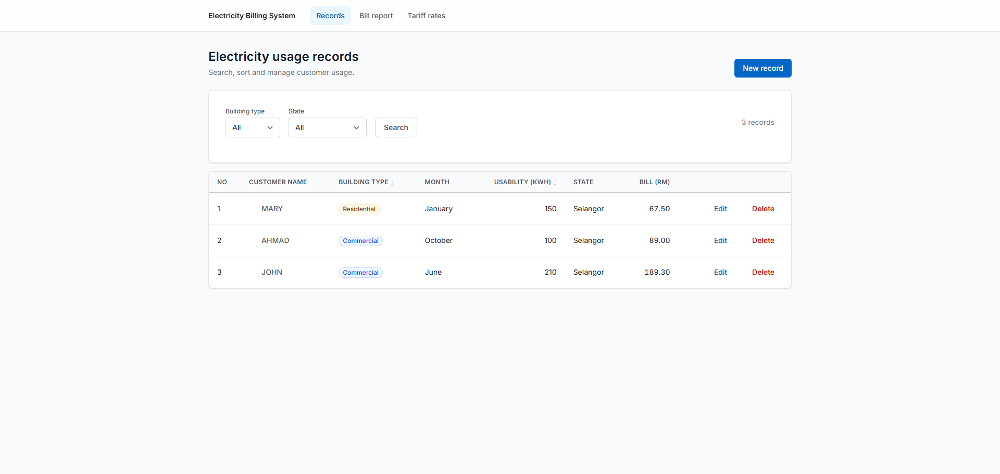
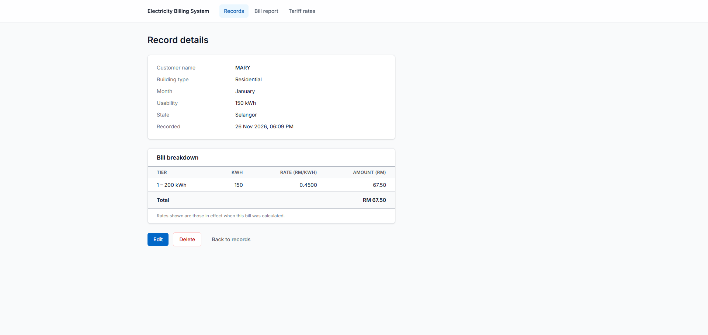
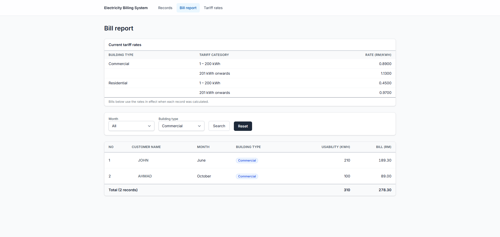
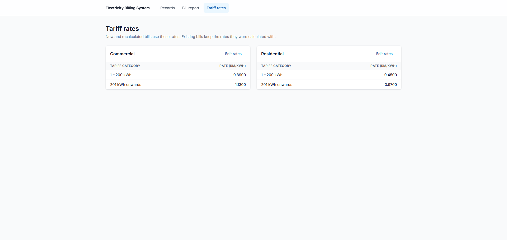
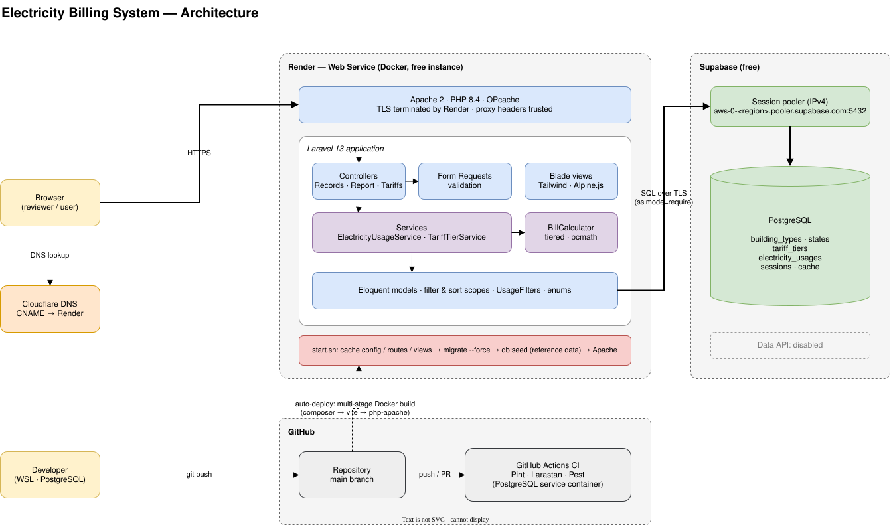

# Electricity Billing System

A Laravel 13 application for recording electricity usage and generating tiered tariff bills.
Built for the iTools PHP skill test.


**Live demo:** https://itools.hazizi.my/

> Hosted on a free tier: the first request after a period of inactivity may take up to a minute while the server wakes up.

| Records                                 | Bill breakdown                           |
| --------------------------------------- | ---------------------------------------- |
|  |    |
| **Bill report**                         | **Tariff rates**                         |
|   |  |

## Features

| Requirement         | Implementation                                                                  |
| ------------------- | ------------------------------------------------------------------------------- |
| a) Save form data   | Create form with server-side validation                                         |
| b) Delete records   | Soft delete with confirmation                                                   |
| c) Update records   | Edit form; bill recalculated only when billing inputs change                    |
| d) Display & search | Filter by building type and state; sort by building type or usability, ASC/DESC |
| e) Bill report      | Filter by month and building type, with totals across all matching records      |

Beyond the brief:

- **Configurable tariff rates**: any number of tiers per building type, edited from the UI with validation
- **Bill breakdown** on each record (units × rate per tier)
- **Frozen bills**: a bill keeps the rates it was calculated with, even after rates change

## Tech stack

| Layer             | Technology                                                                 |
| ----------------- | -------------------------------------------------------------------------- |
| Backend           | PHP 8.4+, Laravel 13                                                       |
| Database          | PostgreSQL                                                                 |
| Frontend          | Blade, Tailwind CSS, Alpine.js, Vite                                       |
| Testing & quality | Pest, Larastan (level 6), Laravel Pint                                     |
| CI                | GitHub Actions (Pint, Larastan and Pest against PostgreSQL)                |
| Deployment        | Docker (PHP + Apache) on Render, PostgreSQL on Supabase, DNS on Cloudflare |

## Local setup

### Requirements

- PHP 8.4+ with `pdo_pgsql` and `bcmath`
- Composer 2
- PostgreSQL 15+ (the schema uses partial unique indexes, CHECK constraints and `jsonb`)
- Node.js 20+

### Install

```bash
git clone git@github.com:HaziziHamdan/electricity-billing-system.git
cd electricity-billing-system

composer install
npm install

cp .env.example .env
php artisan key:generate
```

Create one database for the app and one for tests:

```sql
CREATE USER assessment WITH PASSWORD 'your-password';
CREATE DATABASE assessment_api OWNER assessment;
CREATE DATABASE assessment_api_test OWNER assessment;
```

Set `DB_USERNAME` and `DB_PASSWORD` in `.env`, then:

```bash
php artisan migrate --seed
npm run dev          # or: npm run build
php artisan serve
```

Open http://localhost:8000. Seeding loads the Malaysian states, building types and default tariff rates,
plus demo data: the three sample rows from the brief and 30 random records.

### Tests and quality checks

```bash
vendor/bin/pest                 # unit + feature tests
vendor/bin/phpstan analyse      # static analysis
vendor/bin/pint --test          # code style
```

Tests run against a separate PostgreSQL database (`assessment_api_test`, set in `phpunit.xml`) rather than
SQLite, because the schema relies on PostgreSQL-specific features. Each test runs in a transaction that is
rolled back, so the development database is never touched.

## Deployment

```
Browser ──► Cloudflare DNS ──► Render (Docker: PHP 8.4 + Apache) ──► Supabase PostgreSQL (session pooler)
```



### Docker image

A multi-stage `Dockerfile` keeps the runtime image small:

1. **vendor**: Composer dependencies without dev packages
2. **assets**: Vite / Tailwind production build
3. **runtime**: `php:8.4-apache` with `pdo_pgsql`, `bcmath` and OPcache; serves `public/` on Render's `$PORT`

On start, `docker/start.sh` caches config, routes, views and events from the runtime environment,
runs migrations and the reference-data seeders (idempotent, so safe on every boot), and starts Apache.
Demo records are never seeded in production.

Run the image locally:

```bash
docker build -t electricity-billing .
docker run --rm -p 8080:8080 \
  -e APP_KEY="$(php artisan key:generate --show)" \
  -e APP_ENV=production -e APP_DEBUG=false -e LOG_CHANNEL=stderr \
  -e DB_CONNECTION=pgsql -e DB_HOST=host.docker.internal -e DB_PORT=5432 \
  -e DB_DATABASE=assessment_api -e DB_USERNAME=assessment -e DB_PASSWORD='your-password' \
  --add-host=host.docker.internal:host-gateway \
  electricity-billing
```

### Render

Web Service from this repository with the **Docker** runtime, health check path `/up`, and these environment variables:

| Variable                         | Value                                              |
| -------------------------------- | -------------------------------------------------- |
| `APP_ENV` / `APP_DEBUG`          | `production` / `false`                             |
| `APP_KEY`                        | from `php artisan key:generate --show`             |
| `APP_URL`                        | public URL of the app                              |
| `LOG_CHANNEL`                    | `stderr` (logs appear in Render's log viewer)      |
| `DB_CONNECTION`                  | `pgsql`                                            |
| `DB_HOST` / `DB_PORT`            | Supabase **session pooler** host / `5432`          |
| `DB_DATABASE`                    | `postgres`                                         |
| `DB_USERNAME`                    | `postgres.<project-ref>`                           |
| `DB_PASSWORD`                    | Supabase database password                         |
| `DB_SSLMODE`                     | `require`                                          |
| `SESSION_DRIVER` / `CACHE_STORE` | `database` (the container filesystem is ephemeral) |
| `SESSION_SECURE_COOKIE`          | `true`                                             |

### Notes

- **Session pooler, not the direct connection.** Supabase's direct host is IPv6-only, which Render cannot
  reach; the session pooler accepts IPv4. The transaction pooler is avoided because it conflicts with prepared statements.
- **Supabase Data API is disabled.** The app connects to PostgreSQL directly, so tables are not exposed over REST.
- **Trusted proxies.** Render terminates TLS, so Laravel trusts the proxy headers to generate `https://` URLs.
- **Custom domain.** A Cloudflare CNAME record points to the Render service. Render issues the TLS certificate.

## Design decisions

### Schema

```
building_types ─┬──< tariff_tiers
                └──< electricity_usages >── states
```

- **Reference tables** for building types, states and tariff tiers; nothing is hard-coded in the logic.
- **Tariff tiers store only an upper bound** (`up_to_kwh`, `NULL` = open-ended). Each tier starts where the
  previous one ends, so gaps and overlaps are impossible by design.
- **Rules are enforced in the database**, not only in validation: CHECK constraints (month 1–12, usage ≥ 0,
  rate > 0, bill ≥ 0) and a partial unique index allowing only one open-ended tier per building type.
- **Indexes** on the filter and sort columns. PostgreSQL does not index foreign keys automatically.
- **Foreign keys restrict deletes**, so a state or building type in use cannot be removed.
- **Soft deletes** on usage records.

### Billing

- `BillCalculator` walks the tiers in order and works for any number of tiers. Its core is a pure function
  with full unit-test coverage (tier boundaries, rounding, missing open tier, negative usage).
- **Money uses `bcmath`**, never floats. Each tier line is rounded half-up to the sen, and the total is the sum
  of the rounded lines, so the breakdown always adds up exactly.
- **Bills are frozen**: `bill_amount` and a `tariff_snapshot` (tiers, units, amounts) are stored when the bill
  is calculated. Rate changes never alter past bills, and every bill can be explained later.
- Editing a record recalculates its bill at **current** rates only if usage or building type changes.
- Tariff updates replace all tiers of a building type in a single locked transaction.

### Code structure

```
app/
├── Data/UsageFilters.php            lenient parsing of filter & sort query parameters
├── Enums/                           BuildingTypeCode, Month, SortDirection, UsageSortField
├── Http/Controllers/                thin controllers (records, report, tariffs)
├── Http/Requests/                   validation, incl. cross-row tariff tier rules
├── Models/                          relationships, casts, filter & sort scopes
└── Services/
    ├── ElectricityUsageService.php  create / update / delete with bill calculation
    ├── TariffTierService.php        atomic tier replacement
    └── Billing/                     BillCalculator, BillResult
```

- Sort fields are an enum that acts as an allow-list, so user input never reaches `ORDER BY` directly.
  Invalid filter or sort values fall back to defaults instead of erroring.
- Sorting always ends with a unique tie-breaker (`id`), so pagination is stable.

## Assumptions

1. **The sample bills in the brief do not match its rate table.** Using the rates given:
   JOHN (commercial, 210 kWh) = 200 × 0.89 + 10 × 1.13 = **RM 189.30** (brief: 230.00);
   AHMAD (commercial, 100 kWh) = **RM 89.00** (brief: 120.00);
   MARY (residential, 150 kWh) = **RM 67.50** (brief: 95.00).
   The sample rows are treated as illustrative, and bills follow the rate table.
2. **Commercial second tier**: the brief says "300 kWh onwards", which leaves 201–299 kWh uncovered. It is treated
   as 201 kWh onwards, matching the residential tier. The boundary is configurable from the UI.
3. **Month without year**, as in the form. A production system would also store the billing year.
4. **Usage is whole kWh**, matching the form's example value (159).
5. **No authentication**, as none was requested.

## Future improvements

- Billing year, and tariff rates with an `effective_from` date
- Customers table (normalising customer names)
- Authentication with an audit trail of record and rate changes
- CSV / PDF export of the bill report
- State-specific tariff rates (tiers keyed by building type and state, falling back to a national default)
